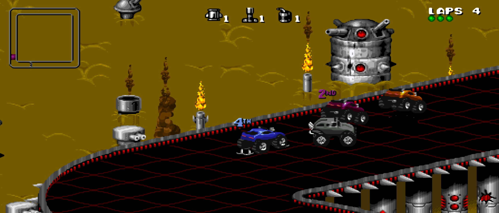
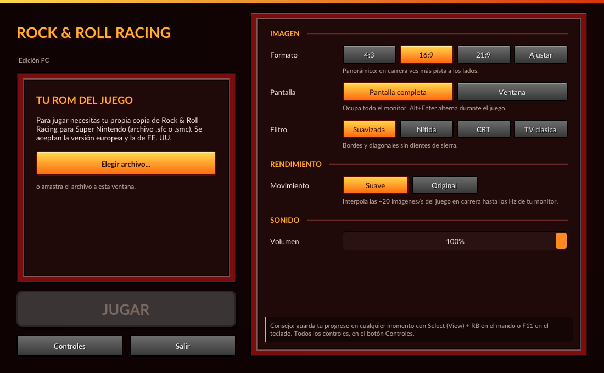
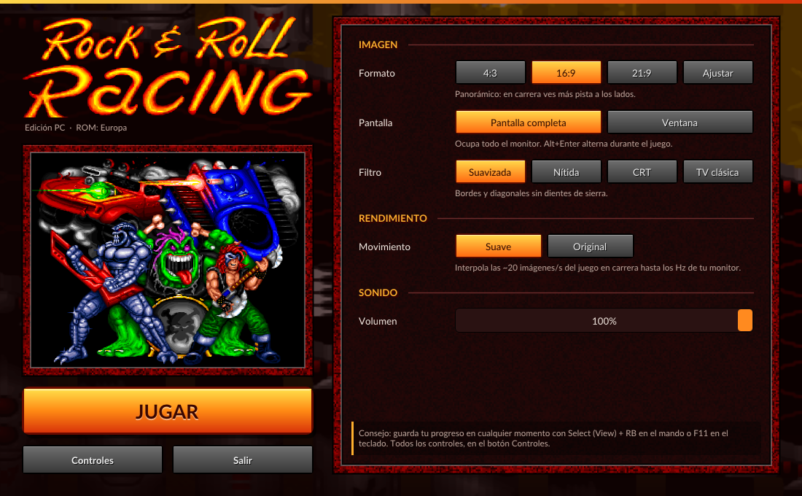
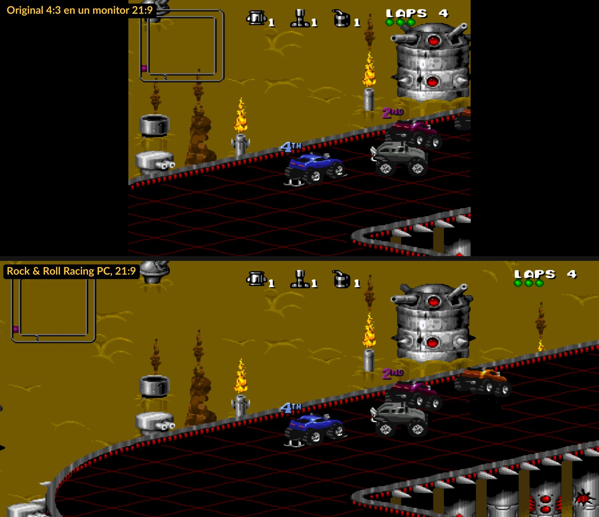
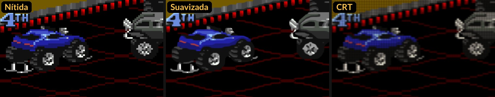
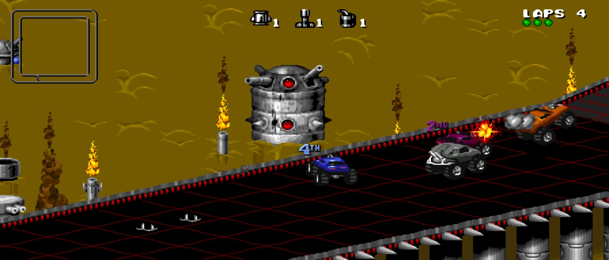
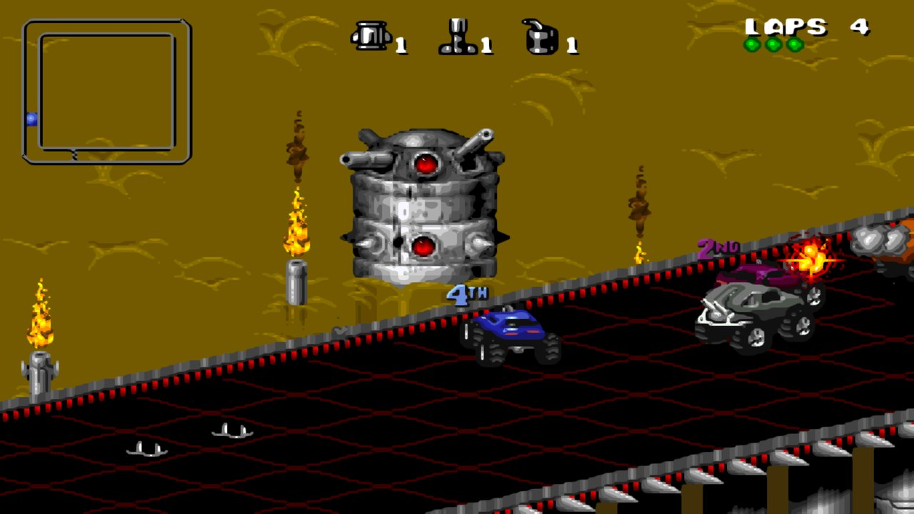
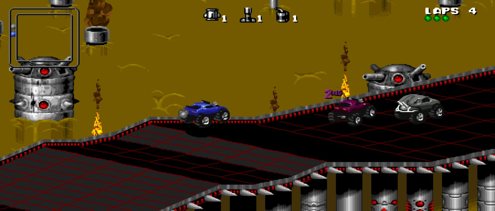

# Rock & Roll Racing — versión nativa para Windows



Una versión nativa para **Windows 10/11** del **Rock & Roll Racing** de Super Nintendo (1993), con
**panorámico real hasta 21:9**, **filtros sin dientes de sierra**, **mando Xbox** y **teclado**, y
**partidas guardadas en cualquier momento**. Todo desde un único programa portátil: lo abres, le
das tu ROM la primera vez y a jugar.

**Este repositorio no contiene nada del juego.** Necesitas tu propia copia (la ROM de Super Nintendo,
`.sfc` o `.smc`).

*English summary at the end.*

## Descarga y uso (sin instalar nada)

1. Descarga **[`RockAndRollRacingPC-windows.zip`](https://github.com/Cris9870/rock-and-roll-racing-pc/releases/latest/download/RockAndRollRacingPC-windows.zip)**
   (en [Releases](https://github.com/Cris9870/rock-and-roll-racing-pc/releases/latest)) y
   descomprímelo en una carpeta normal (Escritorio o Documentos; evita *Archivos de programa*).
2. Abre **`RockNRollRacingSNESRecomp.exe`**. La primera vez te pide **tu ROM**: pulsa
   **Elegir archivo…** o arrástrala a la ventana. Se guarda una copia en la carpeta `rom\` y el
   lanzador prepara su aspecto a partir de ella (unos segundos, solo esa vez).
3. Elige las opciones y pulsa **JUGAR** (Enter, o Start / A en el mando).

La carpeta es portátil: puedes moverla, copiarla a otro PC o llevarla en un USB. Las opciones y las
partidas se guardan dentro de ella.

> **Windows protegió su PC**: al ser un programa nuevo y sin firma digital, Windows puede avisar la
> primera vez. Pulsa **Más información → Ejecutar de todas formas**.

| ROM | Estado |
|---|---|
| *Rock & Roll Racing* (Europa) | Probada de principio a fin |
| *Rock n' Roll Racing* (EE. UU.) | Compatible, **sin verificar todavía**; si la pruebas, cuéntalo en [Issues](https://github.com/Cris9870/rock-and-roll-racing-pc/issues) |

Sirven archivos `.sfc` y `.smc`, con o sin cabecera de copiador. El programa comprueba la ROM y te
avisa si es otra versión o está dañada.

| | |
|---|---|
|  |  |
| La primera vez: elige tu ROM o arrástrala a la ventana | El lanzador, con el aspecto del juego y todas las opciones en español |

## Qué ofrece

| | Original (Super Nintendo, 1993) | Esta versión |
|---|---|---|
| **Programa** | Cartucho o emulador | Programa nativo de Windows, portátil, sin instalación |
| **Panorámico** | 4:3 (en un monitor actual: estirado o con bandas) | **16:9, 21:9 o ajustado a tu monitor**: en carrera **se ve más pista a los lados**, sin deformar. Los menús se muestran en 4:3 con la proporción correcta |
| **Imagen** | Píxeles de 256×224 | Filtros **Suavizada** (Scale2x + antialiasing FXAA: sin dientes de sierra), **Nítida**, **CRT** y **TV clásica** |
| **Fluidez** | Unas 20 imágenes por segundo en carrera | **Movimiento suave** opcional: interpola hasta la frecuencia de tu monitor, sin cambiar la velocidad del juego |
| **Mando** | Mando de SNES | **Mando Xbox** (y PlayStation, Switch Pro…) listo para usar |
| **Teclado** | — | **W A S D** + **J I K L**, **Q / O** para L / R; jugador 2 con flechas y teclado numérico |
| **Guardar** | Contraseñas entre carreras | **Partidas guardadas en cualquier momento** (10 ranuras) y **rebobinado**, también desde el mando |
| **Pantalla** | — | Pantalla completa o ventana (Alt+Enter) |
| **Lanzador** | — | En español, con el aspecto del juego, manejable con ratón, teclado o mando |

## Capturas



Arriba, la vista original (4:3) tal como se vería en un monitor 21:9. Abajo, el mismo instante en
panorámico: la imagen no se estira, se ve más pista a los lados y el marcador se va a los bordes.



Los filtros, de cerca: **Nítida** (píxeles limpios), **Suavizada** (bordes y diagonales sin dientes
de sierra; la opción por defecto) y **CRT** (líneas de un televisor de tubo).



| | |
|---|---|
|  |  |

Capturas en 21:9 (2520×1080) y 16:9 (1920×1080) con el filtro Suavizada, hechas con la versión
europea.

## Controles

| Función | Mando (Xbox) | Teclado |
|---|---|---|
| Dirección | Cruceta | W A S D |
| Botones SNES B · A | A · B | K · L |
| Botones SNES Y · X | X · Y | J · I |
| L · R | LB · RB | Q · O |
| Start · Select | Start · Select (View) | Enter · Mayús derecha |
| **Menú de partidas** | **Select (View) + RB** | F11 |
| Rebobinar | Select (View) + R3 | F12 |
| Carga / guardado rápido | (en el menú) | F1–F10 / Mayús+F1–F10 |

En el menú de partidas: arriba/abajo elige ranura; con el mando, **B** carga, **Y** guarda y **A**
vuelve. El juego queda en pausa mientras está abierto. Otros atajos de teclado: Alt+Enter pantalla
completa, Tab turbo, P pausa, Ctrl+R reiniciar. El botón **Controles** del lanzador muestra esta
misma tabla.

## Preguntas frecuentes

- **¿Dónde se guardan las partidas y las opciones?** En la propia carpeta del programa: `saves\`,
  `config.ini` y `keybinds.ini`. Por eso conviene no ponerla en *Archivos de programa*.
- **¿Cómo cambio de ROM?** Borra la carpeta `rom\` y vuelve a abrir el programa.
- **¿Cómo lo quito?** Borra la carpeta. No instala nada ni escribe en el registro.
- **¿Por qué el `.exe` de la descarga no es "recompilado"?** La descarga ejecuta el juego con el
  intérprete del motor, que trabaja directamente con tu ROM. La versión recompilada lleva código
  traducido de la ROM, así que no se puede distribuir; si quieres, puedes generarla tú mismo con tu
  ROM (ver *Compilar desde el código*). Ambas se juegan igual.
- **Problema conocido:** en **2 jugadores a pantalla partida en 21:9** puede parpadear un bloque de
  gráficos en el margen izquierdo de la mitad superior. Mientras se corrige, usa 4:3 para jugar a
  dos.
- **Algo no funciona**: abre una [incidencia](https://github.com/Cris9870/rock-and-roll-racing-pc/issues)
  indicando tu versión de la ROM (Europa / EE. UU.) y qué estabas haciendo.

Requisitos: **Windows 10 u 11 de 64 bits** con una tarjeta gráfica compatible con OpenGL 3 (cualquiera
de la última década). Unos 10 MB libres.

## Cómo está hecho

El juego no se emula de la forma habitual: está construido sobre
**[snesrecomp](https://github.com/mstan/snesrecomp)**, un *recompilador estático* que traduce el
código 65816 de la Super Nintendo a C, con un runtime nativo para el resto del hardware (gráficos,
sonido, mandos). Parte del port
[fulalas/RockNRollRacingSNESRecomp](https://github.com/fulalas/RockNRollRacingSNESRecomp), pensado
para la ROM de EE. UU.; este proyecto añade:

- **Soporte de la versión europea** (código desplazado, otras direcciones de memoria) y de la de
  EE. UU. con la misma descarga: los parches se localizan por firma de bytes en tu ROM al cargarla.
- **Panorámico** (`src/rnrr_display.c`): la imagen se ensancha hasta 448 píxeles (21:9 exacto, el
  límite antes de que el hardware repita sprites y fondo). Los márgenes se rellenan con el mapa de la
  pista leído de la memoria del juego, se corrige el recorte de sprites (sin "coches fantasma" en los
  bordes) y el marcador se ancla a los bordes de la pantalla.
- **Filtros** (`assets/shaders/`): presets GLSL propios, como Scale2x + FXAA + bilineal nítido.
- **Lanzador** (`src/rnrr_launcher.cpp`, Dear ImGui + SDL3): opciones, controles, comprobación de la
  ROM y su aspecto, que genera a partir de tu ROM en tu PC (`src/rnrr_art.cpp`).
- **Partidas guardadas desde el mando** y el menú de partidas traducido (parche al motor en
  `patches/snesrecomp.patch`).

Notas técnicas detalladas (en inglés), con las direcciones de memoria y cómo se resolvió cada
problema: [docs/TECHNICAL.md](docs/TECHNICAL.md); los cambios al motor, en
[patches/README.md](patches/README.md).

### Compilar desde el código

Requisitos (Windows): [llvm-mingw](https://github.com/mstorsjo/llvm-mingw), CMake, Ninja, Python 3 y
Git Bash.

```sh
git clone --recursive https://github.com/Cris9870/rock-and-roll-racing-pc
cd rock-and-roll-racing-pc
cmake -S . -B build-public -G Ninja -DCMAKE_BUILD_TYPE=Release -DRNRR_PUBLIC_BUILD=ON \
  -DCMAKE_C_COMPILER=x86_64-w64-mingw32-clang -DCMAKE_CXX_COMPILER=x86_64-w64-mingw32-clang++ \
  -DCMAKE_RC_COMPILER=x86_64-w64-mingw32-windres \
  -DSNESRECOMP_STATIC_RUNTIME=ON -DSNESRECOMP_SDL_BACKEND=SDL3 -DSNESRECOMP_FRAME_IMPL=LLE
cmake --build build-public --target RockNRollRacingSNESRecomp
bash tools/package_public.sh build-public      # crea dist/RockAndRollRacingPC-windows.zip
```

La descarga oficial añade además estas opciones de optimización (ejecutable más pequeño y rápido):

```sh
  -DCMAKE_C_FLAGS="-O3 -march=x86-64 -mtune=generic -fno-semantic-interposition -fno-trapping-math -ffunction-sections -fdata-sections -fno-ident" \
  -DCMAKE_CXX_FLAGS="-O3 -march=x86-64 -mtune=generic -fno-semantic-interposition -fno-trapping-math -ffunction-sections -fdata-sections -fno-ident" \
  -DCMAKE_EXE_LINKER_FLAGS="-Wl,--gc-sections -Wl,-O2 -Wl,--strip-all"
```

`RNRR_PUBLIC_BUILD=ON` produce el ejecutable distribuible: no lleva nada derivado de una ROM y
ejecuta el juego con el intérprete del motor.

**Motor recompilado (opcional, solo para uso propio).** Con la ROM europea puedes generar el código C
recompilado (`bash tools/regen.sh --rom <tu ROM>`, necesita Rust 1.97.1 `gnullvm`) y compilar sin
`RNRR_PUBLIC_BUILD`; el lanzador mostrará entonces la opción *Motor: Nativo*. Ese ejecutable contiene
código traducido de tu ROM: **no lo distribuyas.**

## Legal

- Necesitas tu propia copia legal del juego. Ni este repositorio ni la descarga incluyen la ROM ni
  nada sacado de ella (gráficos, sonido o código traducido): el programa trabaja con tu ROM en tu PC.
  Las capturas de esta página son solo ilustrativas.
- Proyecto de aficionados, sin relación con Blizzard Entertainment, Interplay ni Nintendo.
  *Rock n' Roll Racing* es © Blizzard Entertainment.
- El código está bajo **PolyForm Noncommercial 1.0.0** (`LICENSE`): uso y redistribución permitidos
  sin fines comerciales. Terceros en `licenses/`: snesrecomp de Matthew Stanley (PolyForm
  Noncommercial), SDL3 (zlib), Dear ImGui (MIT) y fuentes Lato (SIL OFL 1.1).

---

## English summary

A native Windows 10/11 build of the Super Nintendo **Rock n' Roll Racing** (1993), built on the
[snesrecomp](https://github.com/mstan/snesrecomp) static recompiler and the
[fulalas](https://github.com/fulalas/RockNRollRacingSNESRecomp) port. **Bring your own ROM**: nothing
from the game ships here. Download
[`RockAndRollRacingPC-windows.zip`](https://github.com/Cris9870/rock-and-roll-racing-pc/releases/latest/download/RockAndRollRacingPC-windows.zip),
unzip it, run `RockNRollRacingSNESRecomp.exe`, pick (or drop) your ROM and press **JUGAR**. Features:
true widescreen in races (16:9, 21:9 or fit-to-monitor; menus stay 4:3), jaggy-free image filters
(Scale2x + FXAA), optional motion smoothing to your monitor's refresh rate, Xbox-style gamepads and a
WASD/JIKL keyboard layout, save states and rewind from the pad (Select + RB), and a portable,
game-styled Spanish launcher. The European release is fully tested; the USA release is supported by
byte-signature patching but not yet verified, so reports are welcome. Non-commercial license
(PolyForm Noncommercial 1.0.0).
